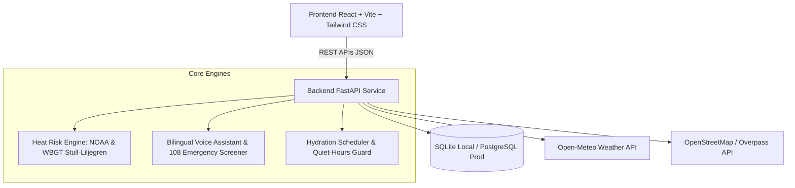

# HeatSafe AI — System Architecture & Methodology

## 1. Architectural Overview

HeatSafe AI is structured as a decoupled, multi-tier public-health and occupational-safety platform designed to operate under low-bandwidth and high-temperature conditions across Tamil Nadu, India.

## 2. Core Service Modules

### A. Heat Risk Engine (`app/services/heat_risk_engine.py`)
1. **NOAA Steadman Heat Index**:
   - Rothfusz 9-parameter polynomial with high-humidity and low-humidity adjustment terms.
   - Evaluates perceived apparent temperature for shaded conditions.
2. **Wet Bulb Globe Temperature (WBGT)**:
   - Stull (2011) psychrometric natural wet bulb temperature calculation ($T_{wb}$) from dry-bulb temperature and relative humidity.
   - Solar radiation flux integration: estimates Globe Temperature ($T_g$) when direct solar irradiance ($W/m^2$) and 10m wind speed ($m/s$) are provided by telemetry.
   - Outdoor WBGT formula: $0.7 T_{wb} + 0.2 T_g + 0.1 T_a$.
   - **Crucial Rule**: When direct solar irradiance is absent from sensor feeds, WBGT is explicitly marked as `Unavailable` to prevent dangerous false confidence.
3. **OSHA & NIOSH Work-Rest Cycles**:
   - Automatically determines work vs rest intervals (e.g. 45m work / 15m rest, 30m / 30m, 15m / 45m).
   - Dynamically calculates hourly hydration requirements (250 mL to 1000 mL/hr).

### B. Bilingual Voice Assistant & Emergency Screener (`app/services/assistant_service.py`)
- **Deterministic Life-Safety Screener**: Instantaneous regex screening for high-threat clinical emergencies (collapse, seizure, lack of sweating, unconsciousness). Bypasses NLP models to immediately deliver 108 emergency ambulance dialing and physical first aid protocols.
- **Curated Knowledge Base Matcher**: Multilingual TF-IDF token matcher indexing official NDMA, OSHA, WHO, and Tamil Nadu Labour Welfare advisories.
- **Web Speech API Integration**: Native browser speech synthesis (`SpeechSynthesisUtterance`) with Tamil (`ta-IN`) and English (`en-IN`) voice output and speech recognition fallback.

### C. Facility Discovery & Verification (`app/services/facility_service.py`)
- Pre-seeded high-accuracy potable water stations and shaded chhavnis across Chennai, Madurai, Coimbatore, Tiruchirappalli, Salem, and Vellore.
- Overpass API dynamic querying with 1-hour bounding-box memory caching.
- Explicit status labeling: `verified`, `reported_unverified`, `temporarily_unavailable`, `closed`.

### D. Employer & Worksite Governance (`app/api/v1/organisations.py`)
- Site-level aggregated heat monitoring preventing individual intrusive surveillance.
- Worksite shade and potable water compliance scoring.
- Non-punitive heat illness and near-miss incident reporting.
